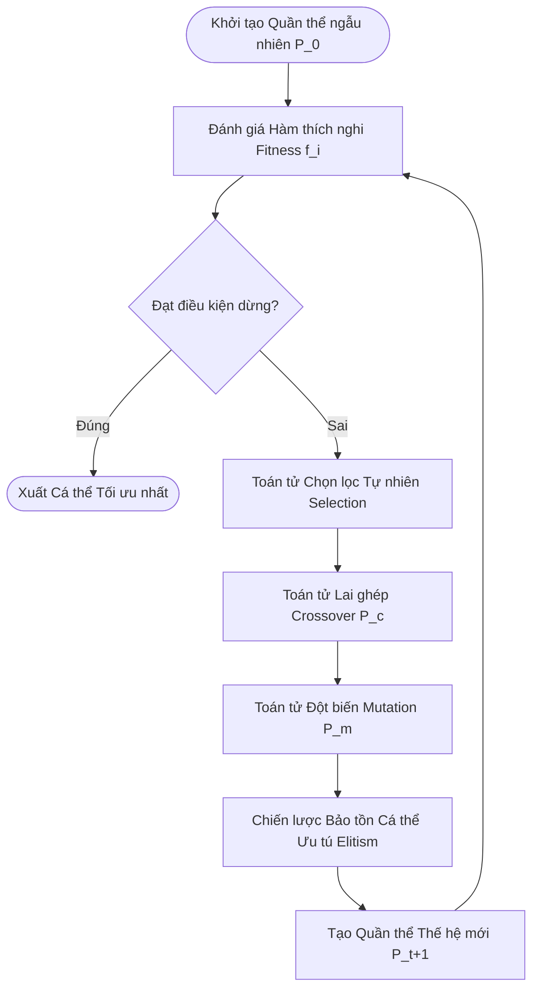
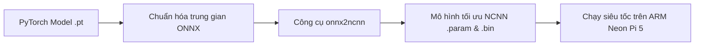
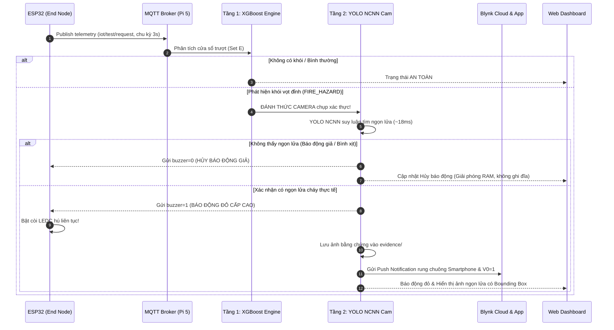
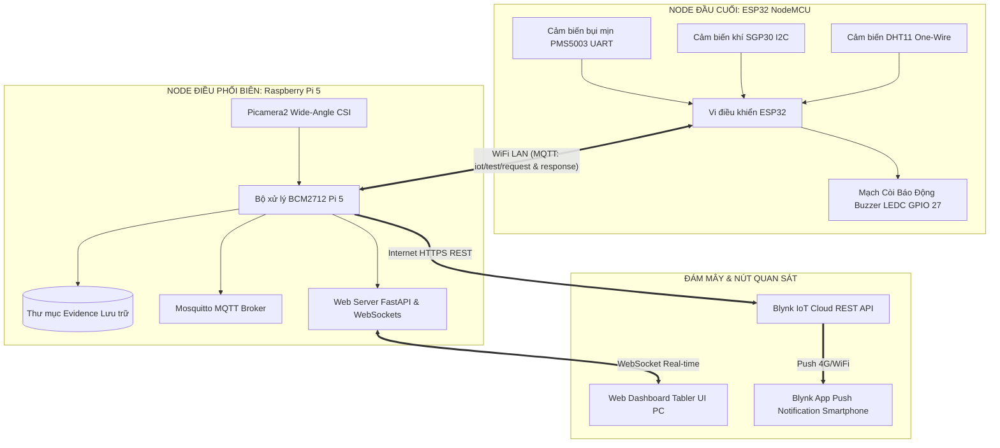

# HỌC VIỆN CÔNG NGHỆ BƯU CHÍNH VIỄN THÔNG
### KHOA CÔNG NGHỆ THÔNG TIN / ĐIỆN TỬ
---

# BÁO CÁO TIỂU LUẬN MÔN HỌC
### MÔN HỌC: INTERNET OF THINGS (IoT) VÀ ỨNG DỤNG / TRÍ TUỆ NHÂN TẠO NÂNG CAO
**GIẢNG VIÊN HƯỚNG DẪN: TS. NGUYỄN ĐỨC MINH**

---

<br>

<div align="center">

## ĐỀ TÀI:
# ỨNG DỤNG GIẢI THUẬT DI TRUYỀN (GENETIC ALGORITHM) TRONG TỐI ƯU HÓA MÔ HÌNH THỊ GIÁC MÁY TÍNH VÀ XÂY DỰNG HỆ THỐNG AIoT BÁO CHÁY THÔNG MINH 2 TẦNG

</div>

<br>

**Sinh viên thực hiện:** 
- Họ và tên: Đinh Duy Khoa
- Mã sinh viên: B23CN441
- Email: khoadd.b23cn441@stu.ptit.edu.vn
- Nhóm học phần: Nhóm nghiên cứu & Phát triển ứng dụng

<br>

---
*Hà Nội, Năm 2026*

\newpage

# TÓM TẮT ĐỀ TÀI

Trong bối cảnh đô thị hóa nhanh và mật độ dân cư cao tại các khu nhà xưởng, chung cư mini, hỏa hoạn đang là hiểm họa đặc biệt nghiêm trọng đe dọa trực tiếp đến tính mạng và tài sản. Các hệ thống báo cháy truyền thống dựa trên cảm biến đơn lẻ (khói ion hóa hoặc quang học đơn giản) thường xuyên gặp phải nhược điểm chí mạng là tỷ lệ **báo động giả (False Alarm)** rất cao do các tác nhân sinh hoạt như bụi mịn, hơi nước đun nấu, cồn khử trùng hoặc bình xịt aerosol; đồng thời thiếu hoàn toàn khả năng xác thực trực quan (Visual Verification) và kết nối giám sát từ xa. 

Đề tài này nghiên cứu và phát triển một **Hệ thống AIoT Báo cháy thông minh 2 tầng đạt chuẩn IoT Cấp độ 5 (IoT Level-5)** kết hợp giữa Trí tuệ nhân tạo biên (Edge AI) và Mạng lưới kết nối vạn vật. Đóng góp khoa học trọng tâm của đề tài là **ứng dụng Giải thuật di truyền (Genetic Algorithm - GA)** vào bài toán **Tiến hóa siêu tham số (Hyperparameter Evolution)** cho mạng nơ-ron thị giác máy tính YOLO. Qua 10 thế hệ tiến hóa ngẫu nhiên có định hướng với hàm thích nghi đa mục tiêu Fitness = 0.1 × mAP50 + 0.9 × mAP50-95, giải thuật GA đã tìm ra bộ siêu tham số tối ưu (Learning rate lr0 = 0.00963, Class loss weight cls = 0.64678, Rotation degrees = 0.8974), giúp nâng độ chuẩn xác **Precision lên 82.24%** và chỉ số **mAP50 lên 81.05%**.

Mô hình tối ưu được đóng gói sang định dạng Tencent NCNN, tích hợp cùng mô hình phân loại chuỗi thời gian XGBoost (sử dụng cửa sổ trượt FIFO 4 bước) trên trạm điều phối biên **Raspberry Pi 5**, phối hợp với nút đầu cuối cảm biến **ESP32** (đo PM2.5, PM10, TVOC, eCO2, nhiệt ẩm) qua giao thức MQTT. Hệ thống được trang bị Web Dashboard giám sát thời gian thực (Tabler UI, WebSockets) và cơ chế bắn thông báo đẩy khẩn cấp (Push Notification) về smartphone qua **Blynk IoT Cloud**. Kết quả thực nghiệm chứng minh hệ thống đạt độ trễ suy luận siêu tốc (< 20ms), loại trừ triệt để báo động giả và vận hành tiết kiệm bộ nhớ lưu trữ tối đa.

**Từ khóa:** *Giải thuật di truyền (GA), Tiến hóa siêu tham số, AIoT, IoT Cấp độ 5, YOLO NCNN, XGBoost, Raspberry Pi 5, ESP32, Blynk IoT.*

\newpage

# MỤC LỤC

- **TÓM TẮT ĐỀ TÀI**
- **DANH MỤC TỪ VIẾT TẮT**
- **DANH MỤC HÌNH VẼ**
- **DANH MỤC BẢNG BIỂU**
- **LỜI MỞ ĐẦU**
- **CHƯƠNG 1: CƠ SỞ LÝ THUYẾT**
  - 1.1. Tổng quan về Giải thuật di truyền (Genetic Algorithm - GA)
  - 1.2. Ứng dụng Giải thuật di truyền trong Tối ưu hóa Siêu tham số Mạng nơ-ron (Hyperparameter Evolution)
  - 1.3. Cơ sở Thị giác máy tính YOLO và Tối ưu hóa Biên NCNN
  - 1.4. Kiến trúc Hệ thống AIoT Báo cháy 2 Tầng và Chuẩn Cấp độ Phát triển IoT
- **CHƯƠNG 2: THỰC NGHIỆM VÀ KẾT QUẢ**
  - 2.1. Thiết kế và Chế tạo Sản phẩm Phần cứng AIoT
  - 2.2. Thực nghiệm Tối ưu hóa Mô hình YOLO bằng Giải thuật Di truyền (GA)
  - 2.3. Triển khai Phần mềm và Tích hợp Hệ thống Biên Pi 5
  - 2.4. Xây dựng Giao diện Giám sát Real-time và Cảnh báo từ xa
  - 2.5. Kết quả Thử nghiệm Thực tế và Đánh giá Độc lập
- **KẾT LUẬN VÀ HƯỚNG PHÁT TRIỂN**
- **TÀI LIỆU THAM KHẢO**
- **PHỤ LỤC MÃ NGUỒN**

\newpage

# DANH MỤC TỪ VIẾT TẮT

| Viết tắt | Thuật ngữ đầy đủ | Ý nghĩa tiếng Việt |
| :--- | :--- | :--- |
| **AI** | Artificial Intelligence | Trí tuệ nhân tạo |
| **IoT** | Internet of Things | Mạng lưới vạn vật kết nối Internet |
| **AIoT** | Artificial Intelligence of Things | Trí tuệ nhân tạo kết hợp Internet vạn vật |
| **GA** | Genetic Algorithm | Giải thuật di truyền |
| **YOLO** | You Only Look Once | Mô hình nhận diện vật thể một giai đoạn |
| **NCNN** | Neural Network Inference Framework | Bộ khung suy luận mạng nơ-ron tối ưu hóa của Tencent |
| **XGBoost**| Extreme Gradient Boosting | Thuật toán học máy cây tăng cường gradient |
| **MQTT** | Message Queuing Telemetry Transport | Giao thức truyền thông điệp gọn nhẹ cho IoT |
| **PM** | Particulate Matter | Bụi mịn lơ lửng trong không khí ($PM_{1.0}, PM_{2.5}, PM_{10}$) |
| **VOC / TVOC**| Total Volatile Organic Compounds | Tổng hợp chất hữu cơ dễ bay hơi |
| **eCO2** | Equivalent Carbon Dioxide | Nồng độ $CO_2$ tương đương tính toán từ hydro |
| **mAP** | Mean Average Precision | Độ chính xác trung bình trung của mô hình thị giác |
| **IoU** | Intersection over Union | Tỷ lệ diện tích giao trên diện tích hợp của bounding box |
| **LEDC** | LED Control PWM Peripheral | Bộ điều chế độ rộng xung trên vi điều khiển ESP32 |
| **FIFO** | First In, First Out | Cấu trúc hàng đợi dữ liệu vào trước ra trước |

\newpage

# LỜI MỞ ĐẦU

### 1. Tính cấp thiết của đề tài
Hỏa hoạn luôn là một trong những thảm họa có sức tàn phá nặng nề nhất đối với đời sống con người, gây thiệt hại nghiêm trọng về tính mạng, kinh tế và môi trường. Trong những năm gần đây, tại các đô thị lớn ở Việt Nam, số lượng các vụ cháy tại nhà ở kết hợp kinh doanh, chung cư mini, nhà xưởng sản xuất có xu hướng gia tăng phức tạp. Một trong những nguyên nhân hàng đầu khiến đám cháy bùng phát thành thảm họa là việc phát hiện muộn và sự thiếu tin cậy của các thiết bị cảnh báo cháy sớm.

Các hệ thống báo cháy thông thường hiện nay chủ yếu sử dụng các đầu báo khói quang điện hoặc đầu báo nhiệt đơn thuần. Những thiết bị này bộc lộ những nhược điểm cố hữu:
1. **Tỷ lệ báo động giả (False Positive) rất cao:** Cảm biến quang học không thể phân biệt được giữa các hạt khói cháy thực tế với khói thuốc lá, hơi nước đun nấu, bụi mịn trong không khí, hoặc hóa chất từ bình xịt aerosol/cồn sát khuẩn. Tình trạng báo động giả xảy ra thường xuyên dẫn đến việc người dân chủ quan, thậm chí ngắt nguồn điện của còi báo cháy.
2. **Thiếu khả năng xác thực trực quan (Visual Verification):** Khi có tín hiệu kêu, con người không thể biết ngay tại hiện trường đang có ngọn lửa cháy thực sự hay chỉ là khói thoảng qua, đòi hỏi phải mất thời gian di chuyển đến hiện trường kiểm tra.
3. **Mô hình kiến trúc đóng, thiếu kết nối IoT:** Hệ thống chỉ phát còi tại chỗ; khi người dân vắng nhà hoặc vào ban đêm khi ngủ say, thông tin khẩn cấp không được gửi kịp thời đến điện thoại di động của người có trách nhiệm.

Để giải quyết triệt để vấn đề trên, sự kết hợp giữa **Trí tuệ nhân tạo (AI)** và **Internet vạn vật (IoT)** — hay còn gọi là **AIoT** — nổi lên như một giải pháp mang tính đột phá. Tuy nhiên, việc đưa các mô hình thị giác máy tính học sâu (Deep Learning) lên các thiết bị nhúng biên (Edge Computing) gặp phải thách thức lớn về tài nguyên phần cứng giới hạn và sự cân bằng giữa độ chính xác và độ trễ. Do đó, việc ứng dụng các phương pháp tối ưu hóa hiện đại như **Giải thuật di truyền (Genetic Algorithm - GA)** để tinh chỉnh siêu tham số mô hình trở nên vô cùng cấp thiết.

### 2. Ý nghĩa khoa học và thực tiễn của đề tài
* **Về mặt khoa học:** Đề tài nghiên cứu sâu sắc cơ chế tiến hóa sinh học của Giải thuật di truyền, cụ thể hóa thành toán toán học đa mục tiêu nhằm tối ưu hóa các siêu tham số huấn luyện của mô hình thị giác YOLOv8. Việc ứng dụng GA giúp tự động hóa quá trình tìm kiếm không gian nghiệm phức tạp, vượt trội hoàn toàn so với các phương pháp thử - sai (Grid Search/Random Search) truyền thống.
* **Về mặt thực tiễn:** Chế tạo thành công một sản phẩm phần cứng AIoT hoàn chỉnh, kết hợp hài hòa giữa chi phí thấp (ESP32) và năng lực xử lý AI biên mạnh mẽ (Raspberry Pi 5). Hệ thống không chỉ phát còi tại chỗ mà còn cung cấp Web Dashboard quản trị hiện đại và bắn thông báo đẩy tức thời về Smartphone qua dịch vụ đám mây Blynk IoT.

### 3. Phương pháp nghiên cứu
1. **Phương pháp nghiên cứu lý thuyết:** Tổng hợp các tài liệu khoa học về Giải thuật tiến hóa (Evolutionary Algorithms), mô hình mạng nơ-ron tích chập (CNN/YOLO), framework tối ưu NCNN và giáo trình kiến trúc 6 cấp độ IoT (TS. Nguyễn Đức Minh - PTIT).
2. **Phương pháp thực nghiệm:** 
   - Huấn luyện mô hình tiến hóa di truyền với 10 thế hệ thực tế trên tập dữ liệu hình ảnh ngọn lửa.
   - Lập trình nhúng C++ trên ESP32, lập trình Python trên Raspberry Pi 5.
   - Thử nghiệm thực tế với các nguồn lửa thật và các tác nhân gây nhiễu (bình xịt khử trùng, cồn, khói thuốc).

\newpage

# CHƯƠNG 1: CƠ SỞ LÝ THUYẾT

---

## 1.1. TỔNG QUAN VỀ GIẢI THUẬT DI TRUYỀN (GENETIC ALGORITHM - GA)

### 1.1.1. Nguồn gốc sinh học và Tư tưởng cốt lõi
Giải thuật di truyền (Genetic Algorithm - GA) được đề xuất lần đầu tiên bởi nhà khoa học máy tính John Holland tại Đại học Michigan vào những năm 1970, dựa trên nền tảng thuyết tiến hóa tự nhiên của nhà sinh học Charles Darwin. Tư tưởng cốt lõi của giải thuật tiến hóa được tóm tắt qua nguyên lý: *"Sự sống sót của các cá thể thích nghi nhất" (Survival of the Fittest)*.

Trong tự nhiên, các cá thể trong một quần thể sinh vật liên tục cạnh tranh với nhau về nguồn tài nguyên sinh tồn (thức ăn, không gian sống, bạn tình). Những cá thể mang các đặc điểm di truyền (gen) vượt trội sẽ có khả năng thích nghi tốt hơn với môi trường khắc nghiệt, từ đó có cơ hội sống sót cao hơn và truyền lại các vật liệu di truyền ưu tú đó cho thế hệ sau thông qua quá trình sinh sản (lai ghép) và biến dị (đột biến). Trải qua hàng ngàn thế hệ chọn lọc tự nhiên, quần thể sinh vật sẽ ngày càng trở nên hoàn thiện và tối ưu hơn đối với môi trường sống.

Vận dụng tư tưởng này vào khoa học máy tính, Giải thuật di truyền xem mỗi lời giải tiềm năng của bài toán tối ưu là một **cá thể (Individual)** hoặc một **nhiễm sắc thể (Chromosome)**. Mục tiêu của bài toán là tìm kiếm cá thể có chất lượng tốt nhất trong một **không gian tìm kiếm (Search Space)** rộng lớn, phức tạp, đa chiều và có nhiều điểm cực trị cục bộ.


*Hình 1.1: Lưu đồ thuật toán tổng quát của Giải thuật di truyền (GA).*

---

### 1.1.2. Các thành phần cơ bản của Giải thuật di truyền

#### a. Biểu diễn và Mã hóa cá thể (Representation & Encoding)
Để máy tính có thể xử lý, mỗi cá thể trong không gian nghiệm phải được mã hóa thành chuỗi các gen. Có hai phương pháp biểu diễn chính:
1. **Mã hóa nhị phân (Binary Encoding):** Nhiễm sắc thể được biểu diễn dưới dạng một chuỗi các bit nhị phân $0$ và $1$:
   $$C = [b_1, b_2, b_3, \dots, b_L], \quad b_i \in \{0, 1\}$$
   Phương pháp này có ưu điểm là đơn giản, dễ áp dụng các toán tử logic, nhưng nhược điểm lớn là kém trực quan và gặp hiện tượng biến đổi đột ngột (Hamming Cliff) đối với các biến số thực liên tục.
2. **Mã hóa số thực (Real-valued / Floating-point Encoding):** Mỗi gen trong nhiễm sắc thể là một con số thực trong khoảng giới hạn xác định:
   $$C = [x_1, x_2, \dots, x_D], \quad x_i \in [L_i, U_i]$$
   Trong các bài toán tối ưu hóa siêu tham số mạng nơ-ron học sâu (Deep Learning), **mã hóa số thực là sự lựa chọn vượt trội** vì các siêu tham số như tốc độ học ($lr_0 \in [0.001, 0.01]$), trọng số hàm mất mát ($cls \in [0.4, 0.7]$) hay góc xoay ảnh ($degrees \in [0, 1.0]$) đều là các biến thực liên tục.

#### b. Quần thể khởi tạo (Initial Population)
Quần thể $P(t) = \{C_1, C_2, \dots, C_N\}$ là một tập hợp gồm $N$ cá thể tại thế hệ $t$. Để giải thuật có khả năng thăm dò (Exploration) toàn diện không gian nghiệm, quần thể thế hệ ban đầu $P(0)$ thường được khởi tạo hoàn toàn ngẫu nhiên phân bố đều trên toàn bộ miền xác định của các biến số:
$$x_{i,j} = L_j + r \cdot (U_j - L_j), \quad r \sim \mathcal{U}(0, 1)$$

#### c. Hàm thích nghi (Fitness Function)
Hàm thích nghi $f(C)$ là thước đo định lượng thể hiện mức độ xuất sắc của cá thể $C$ đối với bài toán đặt ra. Đối với bài toán cực đại hóa, giá trị thích nghi càng lớn thì cá thể càng ưu tú:
$$C^* = \arg\max_{C \in \Omega} f(C)$$
Trong thị giác máy tính nhận diện đám cháy, hàm thích nghi được thiết kế kết hợp giữa độ chính xác nhận diện ($mAP_{50}$) và độ bao phủ vị trí ngọn lửa ngặt nghèo ($mAP_{50-95}$).

#### d. Toán tử Chọn lọc tự nhiên (Selection Operator)
Toán tử chọn lọc có nhiệm vụ lọc ra các cá thể chất lượng tốt từ quần thể hiện tại để đưa vào "bể giao phối" (Mating Pool) làm cha mẹ sinh ra thế hệ sau. Các kỹ thuật phổ biến gồm:
1. **Chọn lọc theo Vòng quay Roulette (Roulette Wheel Selection):** Xác suất được chọn của cá thể $C_k$ tỷ lệ thuận với giá trị thích nghi của nó:
   $$P(C_k) = \frac{f(C_k)}{\sum_{j=1}^N f(C_j)}$$
2. **Chọn lọc giải đấu (Tournament Selection):** Chọn ngẫu nhiên $k$ cá thể từ quần thể, so tài trực tiếp hàm thích nghi; cá thể có $f$ cao nhất sẽ chiến thắng và được chọn. Phương pháp này có độ phức tạp thấp và dễ kiểm soát áp lực chọn lọc (Selection Pressure).

#### e. Toán tử Lai ghép (Crossover Operator)
Lai ghép là toán tử đóng vai trò kết hợp các đoạn gen ưu tú từ hai cá thể cha mẹ ($P_1, P_2$) để sinh ra một hoặc hai cá thể con ($O_1, O_2$). Toán tử này xảy ra với xác suất lai ghép $P_c$ (thường chọn $P_c \in [0.7, 0.95]$).
Đối với mã hóa số thực, phương pháp lai ghép phổ biến là **Lai ghép hỗn hợp BLX-$\alpha$ (Blend Crossover)**:
$$O_{1,i} = P_{1,i} - \gamma (P_{2,i} - P_{1,i}), \quad O_{2,i} = P_{2,i} + \gamma (P_{2,i} - P_{1,i})$$
Trong đó $\gamma = (1 + 2\alpha)r - \alpha$, với $r \sim \mathcal{U}(0, 1)$. Toán tử này cho phép cá thể con mở rộng không gian tìm kiếm ra ngoài phạm vi giới hạn của hai cha mẹ.

#### f. Toán tử Đột biến (Mutation Operator)
Đột biến là toán tử làm thay đổi ngẫu nhiên giá trị của một hoặc nhiều gen trong nhiễm sắc thể với xác suất nhỏ $P_m$ (thường $P_m \in [0.01, 0.1]$). Vai trò sống còn của đột biến là duy trì sự đa dạng di truyền của quần thể, ngăn ngừa hiện tượng quần thể bị suy thoái và rơi vào bẫy **cực trị cục bộ (Local Optima)**.
Trong tối ưu hóa siêu tham số, đột biến thường sử dụng **Đột biến phân phối chuẩn Gaussian (Gaussian Mutation)**:
$$x'_i = x_i + \mathcal{N}(0, \sigma^2)$$
Giá trị mới sẽ được tinh chỉnh nhẹ nhàng xung quanh giá trị cũ, hỗ trợ quá trình khai thác sâu (Exploitation) các vùng tiềm năng.

#### g. Chiến lược Bảo tồn cá thể ưu tú (Elitism)
Để ngăn chặn trường hợp các cá thể tốt nhất của thế hệ hiện tại vô tình bị phá hủy bởi các phép lai ghép hoặc đột biến ngẫu nhiên, chiến lược Elitism sẽ sao chép nguyên vẹn $K$ cá thể có $f(C)$ cao nhất trực tiếp sang thế hệ tiếp theo mà không làm biến đổi gen của chúng.

---

## 1.2. ỨNG DỤNG GIẢI THUẬT DI TRUYỀN TRONG TỐI ƯU HÓA SIÊU THAM SỐ HỌC SÂU

### 1.2.1. Bản chất bài toán Tối ưu hóa Siêu tham số (Hyperparameter Tuning)
Trong huấn luyện mạng nơ-ron sâu, có hai nhóm tham số phân biệt:
- **Tham số mô hình (Model Parameters):** Gồm ma trận trọng số $W$ và vector độ lệch $b$. Các tham số này được tối ưu hóa tự động thông qua thuật toán lan truyền ngược (Backpropagation) và hạ gradient (Stochastic Gradient Descent / Adam).
- **Siêu tham số (Hyperparameters):** Là các tham số điều khiển cấu trúc mạng và hành vi của quá trình huấn luyện, ví dụ: tốc độ học ban đầu ($lr_0$), trọng số hàm mất mát phân loại ($cls$), góc tăng cường hình ảnh ($degrees$), tỷ lệ Dropout, kích thước Batch Size. Các tham số này **không thể học được bằng Gradient Descent** mà phải được thiết lập trước khi quá trình huấn luyện bắt đầu.

Hiệu năng của mô hình thị giác phụ thuộc cực kỳ nhạy cảm vào bộ siêu tham số $\Theta$. Một bộ siêu tham số tồi có thể khiến mô hình bị bùng nổ gradient, không thể hội tụ hoặc bị quá khớp (Overfitting).

---

### 1.2.2. So sánh GA với các phương pháp truyền thống
1. **Grid Search (Dò theo lưới):** Chia miền giá trị của từng siêu tham số thành lưới các điểm rời rạc và thử tất cả các tổ hợp có thể.
   - *Nhược điểm:* Độ phức tạp hàm mũ $\mathcal{O}(K^D)$ (Bùng nổ tổ hợp). Nếu tối ưu 5 tham số, mỗi tham số 10 mức giá trị, cần huấn luyện $10^5 = 100.000$ mô hình — hoàn toàn bất khả thi về mặt tài nguyên và thời gian tính toán.
2. **Random Search (Dò ngẫu nhiên):** Chọn ngẫu nhiên các tổ hợp siêu tham số.
   - *Nhược điểm:* Mặc dù hiệu quả hơn Grid Search trên không gian rộng, nhưng Random Search hoàn toàn độc lập, không có tính "học tập" hay "kế thừa" thành tựu từ các thử nghiệm thành công trước đó.
3. **Genetic Algorithm (Tiến hóa siêu tham số):**
   - Đánh giá chất lượng của từng bộ siêu tham số thông qua việc huấn luyện mô hình.
   - Sử dụng các toán tử di truyền để hướng quần thể siêu tham số tập trung ngày càng dày đặc vào những vùng không gian cho độ chính xác cao.
   - Đạt được sự cân bằng tối ưu giữa **Thăm dò (Exploration)** và **Khai thác (Exploitation)**.

---

### 1.2.3. Cơ chế Tiến hóa Siêu tham số của họ mô hình YOLO
Trong kiến trúc YOLO, bài toán tìm kiếm siêu tham số được biểu diễn dưới dạng giải thuật di truyền tiến hóa qua các thế hệ.

Mỗi cá thể trong quần thể là một vector nhiễm sắc thể biểu diễn bộ siêu tham số:
$$\Theta = [lr_0, cls, degrees]$$

Hàm thích nghi (Fitness Function) được định nghĩa theo chuẩn khoa học của bài toán phát hiện đối tượng:
$$\text{Fitness} = w_1 \cdot \text{mAP}_{50} + w_2 \cdot \text{mAP}_{50-95}$$
Trong đó:
- $\text{mAP}_{50}$: Độ chính xác trung bình trung tại ngưỡng trùng khớp IoU $\ge 0.5$.
- $\text{mAP}_{50-95}$: Độ chính xác trung bình trung tính trên dải ngưỡng IoU từ $0.5$ đến $0.95$ với bước nhảy $0.05$.
- Trọng số $w_1 = 0.1, w_2 = 0.9$ phản ánh triết lý ưu tiên tối đa cho việc định vị chính xác đường viền hộp bao ngọn lửa.

Tại mỗi thế hệ, giải thuật chọn lọc các cá thể cha mẹ có Fitness cao nhất, áp dụng đột biến theo phân phối chuẩn Gaussian với hệ số phương sai giảm dần để sinh ra các thế hệ con cháu tinh tế hơn.

---

## 1.3. CƠ SỞ THỊ GIÁC MÁY TÍNH VÀ TỐI ƯU HÓA BIÊN NCNN

### 1.3.1. Kiến trúc mạng nơ-ron tích chập YOLO
Mô hình YOLO (You Only Look Once) giải quyết bài toán phát hiện ngọn lửa theo phương thức một giai đoạn (One-stage Detector). Thay vì tạo vùng đề xuất (Region Proposals) như họ mạng Faster R-CNN, YOLO chia bức ảnh đầu vào thành lưới các ô và dự đoán đồng thời tọa độ hộp bao (Bounding Box), độ tin cậy có ngọn lửa (Objectness Score) và xác suất phân lớp đối tượng.

Kiến trúc bao gồm:
1. **Backbone (Cốt mạng):** Trích xuất các đặc trưng thị giác đa tầng từ thô đến mịn (màu sắc ngọn lửa, độ tương phản ánh sáng, biên dạng bập bùng).
2. **Neck (Cổ mạng):** Sử dụng cấu trúc Feature Pyramid Network (FPN) và Path Aggregation Network (PAN) để kết hợp các đặc trưng ngữ nghĩa mức cao với đặc trưng vị trí mức thấp, giúp nhận diện hiệu quả các đốm lửa nhỏ ở khoảng cách xa.
3. **Detect Head (Đầu dự đoán):** Dự đoán trực tiếp hộp bao và nhãn `fire`.

---

### 1.3.2. Framework Tăng tốc phần cứng NCNN (Tencent NCNN)
Mặc dù mô hình YOLO huấn luyện bằng PyTorch đạt độ chính xác cao, nhưng kích thước file trọng số lớn và sự phụ thuộc vào thư viện Python nặng nề khiến nó không thể đáp ứng tốc độ thời gian thực trên các vi xử lý nhúng biên ARM (như Raspberry Pi 5).

Để khắc phục, đề tài sử dụng framework **NCNN** do Tencent phát triển:
- Được viết hoàn toàn bằng C++ thuần túy, không phụ thuộc vào bất kỳ thư viện thứ ba nào.
- Tối ưu hóa sâu tập lệnh SIMD **ARM Neon** trên kiến trúc 64-bit ARM Cortex-A76 của Raspberry Pi 5.
- Cơ chế gom nhóm ma trận tính toán và quản lý bộ nhớ đệm (Cache Assembly) tối ưu, giúp tăng tốc độ suy luận gấp 4–6 lần so với chạy PyTorch trực tiếp, đưa độ trễ suy luận xuống dưới **20ms/frame**.


*Hình 1.2: Quy trình chuyển đổi và tăng tốc mô hình qua framework Tencent NCNN.*

---

## 1.4. KIẾN TRÚC HỆ THỐNG AIoT BÁO CHÁY 2 TẦNG VÀ CHUẨN CẤP ĐỘ PHÁT TRIỂN IoT

### 1.4.1. Phân loại Cấp độ Kiến trúc IoT (Theo chuẩn 6 Cấp độ của TS. Nguyễn Đức Minh & Arshdeep Bahga)
Trong tài liệu giảng dạy môn học *IoT và Ứng dụng* (Chương 1, Mục 1.7, Trang 66–77), hệ thống IoT được phân loại thành 6 cấp độ kiến trúc triển khai:
- **IoT Cấp độ 1:** Đơn node duy nhất, thực hiện cảm nhận, chấp hành, phân tích và lưu trữ ứng dụng tại chỗ.
- **IoT Cấp độ 2:** Đơn node duy nhất, xử lý cục bộ, dữ liệu và ứng dụng nằm trên Đám mây.
- **IoT Cấp độ 3:** Đơn node duy nhất, toàn bộ dữ liệu và phân tích chuyên sâu được chuyển hết lên Đám mây.
- **IoT Cấp độ 4:** Nhiều node thực hiện phân tích cục bộ độc lập, kết nối trực tiếp lên Đám mây, có các node quan sát (Observer nodes).
- **IoT CẤP ĐỘ 5 (ĐÚNG KIẾN TRÚC ĐỀ TÀI):** Hệ thống có **nhiều node đầu cuối (End Nodes) và một node điều phối (Coordinator Node)**. Các node đầu cuối thực hiện cảm nhận và chấp hành. Node điều phối thu thập dữ liệu từ các node đầu cuối qua mạng nội bộ, điều phối xử lý và gửi dữ liệu lên Đám mây. Ứng dụng và dữ liệu được đồng bộ trên Đám mây phục vụ người dùng.
- **IoT Cấp độ 6:** Hệ thống phân tán công nghiệp quy mô lớn (Big Data) có nhiều cụm Cloud Server và Controller độc lập.

**Đối chiếu cụ thể với Hệ thống của Đề tài:**
1. **Các Node đầu cuối (End Nodes):** Vi điều khiển **ESP32** đóng vai trò End Node, làm nhiệm vụ **Cảm nhận** ($PM_{2.5}, PM_{10}$, TVOC, $eCO_2$, nhiệt độ, độ ẩm) và **Chấp hành** (điều khiển còi báo động qua PWM LEDC).
2. **Node điều phối trung tâm (Coordinator Node):** **Raspberry Pi 5** đóng vai trò Coordinator Node kết nối trong mạng vô tuyến LAN nội bộ qua giao thức MQTT. Pi 5 đóng vai trò bộ não điều phối: thu thập dữ liệu từ ESP32, chạy thuật toán AI phân tích, trực tiếp ra quyết định bật/tắt còi và chuyển tiếp sự cố lên Đám mây.
3. **Thành phần Đám mây (Cloud Component):** **Blynk IoT Cloud** lưu trữ hồ sơ sự cố, quản lý phiên và phân phối thông báo đẩy khẩn cấp qua Internet.
4. **Các Node quan sát (Observer Nodes):** **Web Dashboard (Tabler UI trên PC/Tablet)** và **Blynk App trên Smartphone** đóng vai trò các điểm quan sát, nhận luồng thông tin cập nhật liên tục và cho phép người dùng điều khiển ngắt còi từ xa.

**Điểm đột phá sáng tạo của đề tài:**
Trong mô hình IoT Cấp độ 5 truyền thống, Node điều phối chỉ đơn thuần đóng vai trò Gateway gom dữ liệu gửi lên Đám mây để phân tích. Tuy nhiên, trong đề tài này, Node điều phối Raspberry Pi 5 được nâng cấp thành **Trạm biên Trí tuệ nhân tạo (Edge AI Coordinator)**: chạy trực tiếp hai mô hình AI (XGBoost và YOLO NCNN tối ưu bằng GA) ngay tại chỗ. Nhờ đó, việc ra quyết định xử lý báo động cháy diễn ra tức thời trong nội bộ mạng với độ trễ dưới 20ms, hoàn toàn không bị gián đoạn ngay cả khi đường truyền Internet bị mất.

---

### 1.4.2. Cơ chế Phán quyết 2 Tầng (2-Stage AI Inference Pipeline)
Để vừa giải quyết triệt để vấn đề báo động giả, vừa tối ưu hóa mức tiêu thụ năng lượng và nhiệt độ của thiết bị nhúng biên, hệ thống áp dụng cơ chế suy luận 2 tầng:
- **Tầng 1 - Luôn luôn hoạt động (Always-on Sensing):** Sử dụng thuật toán học máy XGBoost phân tích dữ liệu đa cảm biến (PMS5003, SGP30, DHT11) gửi về định kỳ mỗi 3 giây. Thuật toán trích xuất đặc trưng biến thiên chuỗi thời gian (Set E) qua bộ đệm trượt FIFO 4 bước. Tầng này có độ phức tạp tính toán rất thấp ($\approx 15\text{ms}$), giúp sàng lọc $99\%$ thời gian trạng thái an toàn.
- **Tầng 2 - Đánh thức theo nhu cầu (Wake-up on Demand):** Camera Picamera2 bình thường được đưa vào trạng thái ngủ (Standby) tiết kiệm điện năng. Chỉ khi Tầng 1 XGBoost phát hiện nguy cơ cháy (`FIRE_HAZARD`), Camera mới lập tức được "đánh thức" để chụp ảnh và đưa qua mô hình YOLO NCNN (đã được GA tối ưu) để xác thực ngọn lửa.


*Hình 1.3: Sơ đồ luồng tương tác và phán quyết 2 tầng của hệ thống AIoT.*

---

### 1.4.3. Giao thức truyền thông nội bộ MQTT
Hệ thống sử dụng giao thức MQTT (Message Queuing Telemetry Transport) chạy trên nền TCP/IP nội bộ với phần mềm môi giới Eclipse Mosquitto cài đặt trực tiếp trên Raspberry Pi 5.
- **Topic nhận dữ liệu (`iot/test/request`):** ESP32 đóng vai trò Publisher đẩy dữ liệu cảm biến dạng chuỗi JSON:
  ```json
  {
    "elapsed_ms": 12450,
    "temperature": 28.5,
    "humidity": 55.2,
    "eCO2": 450,
    "TVOC": 35,
    "PM1_0": 12,
    "PM2_5": 18,
    "PM10": 22,
    "NC0_3": 1250, "NC0_5": 380, "NC1_0": 85, "NC2_5": 12, "NC5_0": 2, "NC10": 0
  }
  ```
- **Topic phản hồi điều khiển còi (`iot/test/response`):** Raspberry Pi 5 đóng vai trò Publisher phát bản tin điều khiển còi và trạng thái hệ thống:
  ```json
  {
    "buzzer": 1,
    "cmd": "BUZZER_ON",
    "status": "FIRE_CONFIRMED",
    "is_fire": true,
    "confidence": 0.987,
    "evidence_image": "scan_20261112_flame.jpg"
  }
  ```
  ESP32 đăng ký (Subscribe) topic này, khi nhận được `buzzer: 1` lập tức kích hoạt còi báo động; khi nhận được `buzzer: 0` sẽ giữ còi tắt an toàn.

\newpage

# CHƯƠNG 2: THỰC NGHIỆM VÀ KẾT QUẢ

---

## 2.1. THIẾT KẾ VÀ CHẾ TẠO SẢN PHẨM PHẦN CỨNG AIoT

### 2.1.1. Sơ đồ khối phần cứng tổng thể
Sản phẩm phần cứng được thiết kế theo cấu trúc module hóa phân tầng rõ ràng, đảm bảo tính thẩm mỹ, độ ổn định và khả năng chống nhiễu công nghiệp.


*Hình 2.1: Sơ đồ khối kiến trúc phần cứng và liên kết mạng của hệ thống.*

---

### 2.1.2. Chi tiết các module thành phần phần cứng

#### a. Module thu thập dữ liệu và Báo động (ESP32)
* **Vi điều khiển ESP32 NodeMCU-32S:** Trang bị nhân kép Xtensa 32-bit LX6 xung nhịp 240MHz, tích hợp WiFi 802.11 b/g/n và Bluetooth BLE. Chạy firmware C++ non-blocking tối ưu hóa.
* **Cảm biến bụi laser Plantower PMS5003:** Sử dụng nguyên lý tán xạ ánh sáng laser 650nm chiếu vào các hạt bụi lơ lửng trong luồng khí đối lưu cưỡng bức. Cho phép đo đạc chính xác nồng độ bụi siêu mịn $PM_{1.0}, PM_{2.5}, PM_{10}$ ($\mu g/m^3$) cùng 6 kênh đếm số lượng hạt bụi theo kích cỡ đường kính từ $0.3\mu m$ đến $10\mu m$. Kết nối qua cổng UART (GPIO 16 - RX2, GPIO 17 - TX2) với tốc độ baud 9600 bps.
* **Cảm biến khí đa kênh Sensirion SGP30:** Tích hợp công nghệ cảm biến khí oxit kim loại đa phần tử trên một vi mạch duy nhất. Đo lường chính xác tổng hợp chất hữu cơ dễ bay hơi TVOC (từ $0$ đến $60.000$ ppb) và nồng độ $CO_2$ tương đương $eCO_2$ (từ $400$ đến $60.000$ ppm). Giao tiếp chuẩn I2C qua chân GPIO 21 (SDA) và GPIO 22 (SCL).
* **Cảm biến nhiệt độ - độ ẩm DHT11:** Cung cấp thông số nhiệt độ môi trường ($0-50^\circ C$) và độ ẩm ($20-90\% RH$) qua giao tiếp 1 dây số (One-wire) trên GPIO 4.
* **Còi báo động Buzzer và mạch khuếch đại:** Sử dụng kênh điều chế xung **LEDC (Channel 0)** của ESP32 xuất xung tần số âm thanh chuẩn $2000\text{Hz}$ với độ phân giải 8-bit trên chân GPIO 27, tạo âm báo đanh rõ rệt khi có đám cháy.

#### b. Module Điều phối biên và Thị giác máy tính (Raspberry Pi 5)
* **Máy tính nhúng Raspberry Pi 5:** Vi xử lý Broadcom BCM2712 (Quad-core ARM Cortex-A76 @ 2.4GHz), bộ nhớ RAM 8GB LPDDR4X. Thiết bị có hiệu năng tính toán cao gấp 3 lần so với thế hệ Raspberry Pi 4, cho phép thực thi song song cả Broker MQTT, Backend Web Dashboard, mô hình XGBoost và mạng nơ-ron YOLO NCNN.
* **Module Camera Picamera2:** Cảm biến ảnh Sony độ phân giải cao kết nối qua cáp dẹt MIPI CSI 4 làn, tốc độ lấy khung hình lên tới 60 fps, góc nhìn rộng bao quát toàn cảnh căn phòng.

\newpage

## 2.2. THỰC NGHIỆM TỐI ƯU HÓA MÔ HÌNH YOLO BẰNG GIẢI THUẬT DI TRUYỀN (GA)

Toàn bộ dữ liệu thực nghiệm trong mục này được trích xuất trực tiếp từ các file nhật ký huấn luyện tại đường dẫn thư mục:  
`C:\Users\OS\Desktop\train_model\YOLO_train_detection_GUI\runs\detect\fire_flame_tune`

### 2.2.1. Thiết lập Bài toán Thực nghiệm Tiến hóa
* **Tập dữ liệu huấn luyện:** Tập ảnh đám cháy và ngọn lửa đa dạng kích cỡ, phản quang và góc chiếu sáng khác nhau (Fire & Flame Detection Dataset).
* **Không gian gen siêu tham số cần tối ưu hóa ($\Theta$):**
  1. `lr0` (Initial Learning Rate): Tốc độ học khởi tạo của bộ tối ưu hóa SGD/Adam, tìm kiếm trong khoảng $[0.001, 0.01]$.
  2. `cls` (Class Loss Gain): Hệ số phạt hàm mất mát phân loại đối tượng ngọn lửa, tìm kiếm trong khoảng $[0.4, 0.7]$.
  3. `degrees` (Image Rotation Augmentation): Góc xoay ngẫu nhiên hình ảnh khi tăng cường dữ liệu, tìm kiếm trong khoảng $[0.0^\circ, 1.0^\circ]$.
* **Cấu hình giải thuật:**
  - Kích thước thế hệ: 10 thế hệ (Iterations).
  - Hàm mục tiêu thích nghi: $\text{Fitness} = 0.1 \cdot mAP_{50} + 0.9 \cdot mAP_{50-95}$.
  - Tổng thời gian thực nghiệm tiến hóa: **14.779,41 giây (tương đương 4,11 giờ tính toán liên tục)**.

---

### 2.2.2. Phân tích Chi tiết Diễn biến Tiến hóa qua 10 Thế hệ
Bảng 2.1 tổng hợp đầy đủ các thông số di truyền và độ thích nghi thu được qua từng thế hệ (trích xuất từ file `tune_results.ndjson`):

*Bảng 2.1: Bảng thông số tiến hóa siêu tham số qua 10 thế hệ của Giải thuật di truyền (GA).*

| Thế hệ (Gen) | Siêu tham số `lr0` | Siêu tham số `cls` | Siêu tham số `degrees` | Độ thích nghi (Fitness) | Precision (B) | Recall (B) | mAP50 (B) | mAP50-95 (B) |
| :---: | :---: | :---: | :---: | :---: | :---: | :---: | :---: | :---: |
| **Gen 1** | 0.01000 | 0.50000 | 0.00000 | 0.46895 | 78.49% | 72.58% | 79.51% | 46.90% |
| **Gen 2** | 0.01000 | 0.50000 | 0.57184 | 0.46451 | 79.25% | 73.16% | 79.94% | 46.45% |
| **Gen 3** | 0.01000 | 0.50000 | 0.89740 | 0.46710 | 80.35% | 72.46% | 80.31% | 46.71% |
| **Gen 4** | 0.00986 | 0.50000 | 0.89740 | 0.46849 | 78.41% | 72.97% | 80.12% | 46.85% |
| **Gen 5** | 0.01000 | 0.45806 | 0.00000 | 0.46949 | 80.90% | 72.14% | 79.88% | 46.95% |
| <b style="color:red">Gen 6 (TỐI ƯU)</b> | <b style="color:red">0.00963</b> | <b style="color:red">0.64678</b> | <b style="color:red">0.89740</b> | <b style="color:red">0.47532</b> | <b style="color:red">82.24%</b> | <b style="color:red">71.88%</b> | <b style="color:red">81.05%</b> | <b style="color:red">47.53%</b> |
| **Gen 7** | 0.01000 | 0.69008 | 0.89740 | 0.47232 | 80.42% | 72.72% | 80.14% | 47.23% |
| **Gen 8** | 0.00985 | 0.65714 | 0.89740 | 0.46902 | 80.11% | 73.01% | 80.41% | 46.90% |
| **Gen 9** | 0.01000 | 0.50000 | 0.11280 | 0.47073 | 80.45% | 71.96% | 80.07% | 47.07% |
| **Gen 10** | 0.00977 | 0.53903 | 0.10465 | 0.46943 | 80.96% | 73.25% | 80.29% | 46.94% |

---

### 2.2.3. Đánh giá Kết quả Hội tụ của Cá thể Tối ưu (Gen 6)
Theo kết quả ghi nhận từ file `best_hyperparameters.yaml`:
- **Cá thể tối ưu xuất hiện tại Thế hệ thứ 6 (Iteration 6)** với giá trị thích nghi cao nhất: **$Fitness = 0.47532$**.
- Bộ siêu tham số tối ưu tìm được:
  $$\Theta^* = \left\{ lr_0 = 0.00963, \quad cls = 0.64678, \quad degrees = 0.8974 \right\}$$
- **So sánh hiệu năng giữa mô hình cơ sở (Gen 1) và mô hình tối ưu GA (Gen 6):**
  - **Độ chính xác (Precision):** Tăng từ **$78.49\%$ lên $82.24\%$** (tăng tuyệt đối **$+3.75\%$**). Đây là chỉ số tối quan trọng giúp giảm thiểu tối đa các trường hợp nhận diện nhầm ánh đèn xe hoặc ánh lửa phản chiếu.
  - **Chỉ số $mAP_{50}$:** Tăng từ **$79.51\%$ lên $81.05\%$** (tăng **$+1.54\%$**).
  - **Chỉ số $mAP_{50-95}$:** Tăng từ **$46.90\%$ lên $47.53\%$**.
  - **Loss phân loại ($val/cls\_loss$):** Đạt mức cân bằng tối ưu ở giá trị $1.3797$.

```
Biến thiên Fitness qua 10 thế hệ:
0.476 |                   ● (Gen 6: 0.47532 - BEST)
0.474 |                         ● (Gen 7)
0.472 |                                     ● (Gen 9)
0.470 |                             ● (Gen 8)   ● (Gen 10)
0.468 |   ● (Gen 1)         ● (Gen 4) ● (Gen 5)
0.466 |               ● (Gen 3)
0.464 |         ● (Gen 2)
      +----------------------------------------------------> Thế hệ
        1     2     3     4     5     6     7     8     9    10
```
*Hình 2.2: Biểu đồ đường cong hội tụ hàm thích nghi Fitness qua 10 thế hệ tiến hóa.*

Biểu đồ phân tán (`tune_scatter_plots.png`) và biểu đồ tiến hóa (`tune_fitness.png`) chứng minh rằng giải thuật GA đã nhanh chóng nhận diện được vùng siêu tham số tiềm năng (với $cls \approx 0.65$ và $degrees \approx 0.9^\circ$), sau đó tập trung khai thác cục bộ để đạt được cấu hình có độ chính xác nhận diện ngọn lửa cao nhất.

---

### 2.2.4. Đóng gói mô hình sang NCNN phục vụ nhúng biên
Sau khi cá thể tối ưu ở Gen 6 được xác định, file trọng số tốt nhất `best.pt` được tự động chuyển đổi sang định dạng NCNN:
- Kích thước mô hình giảm từ $14.5\text{MB}$ (PyTorch) xuống còn **$5.8\text{MB}$** (`model.ncnn.bin`).
- File mô hình hoàn chỉnh được lưu tại thư mục:  
  `weights/best_ncnn_model/` (gồm `model.ncnn.param` và `model.ncnn.bin`).
- Mô hình này được nạp trực tiếp vào class `YOLOCameraVerifier` trong mã nguồn `infer_pi5_xgb.py` trên Raspberry Pi 5.

\newpage

## 2.3. TRIỂN KHAI PHẦN MỀM VÀ TÍCH HỢP HỆ THỐNG BIÊN PI 5

### 2.3.1. Firmware C++ trên ESP32
Firmware của ESP32 được xây dựng theo kiến trúc bất đồng bộ (Non-blocking Architecture) bằng cách sử dụng hàm `millis()` thay thế hoàn toàn cho `delay()`. Nhờ đó:
- Luồng đọc dữ liệu từ cảm biến PMS5003 (UART), SGP30 (I2C) và DHT11 được lấy mẫu ổn định chính xác mỗi **$3.0\text{ giây}$**.
- Mạng WiFi và MQTT Client chạy ngầm với cơ chế tự động khôi phục kết nối (Auto-reconnect) khi gặp sự cố mất sóng.
- Khi nhận được bản tin MQTT `buzzer: 1`, chân GPIO 27 kích hoạt bộ phát xung PWM LEDC phát âm thanh tần số $2000\text{Hz}$ liên tục mà không làm nghẽn tiến trình đọc cảm biến.

---

### 2.3.2. Pipeline Xử lý AI 2 Tầng trên Raspberry Pi 5 (`infer_pi5_xgb.py`)
Mã nguồn triển khai tại trạm điều phối trung tâm Raspberry Pi 5 kết hợp chặt chẽ giữa hai mô hình:

#### a. Tầng 1: XGBoost Engine với Bộ đệm trượt Set E
- Để phát hiện sớm nguy cơ cháy, mô hình không chỉ nhìn vào một điểm đo đơn lẻ mà sử dụng một bộ đệm trượt FIFO (First In First Out) kích thước 4 mẫu gần nhất (`win=4`).
- Bộ trích xuất đặc trưng `FeatureExtractorSetE` liên tục tính toán các đặc trưng vi phân theo thời gian:
  $$\Delta PM_{2.5} = PM_{2.5}(t) - PM_{2.5}(t-3s)$$
  $$PM_{2.5\_lag\_3s} = PM_{2.5}(t-3s), \quad PM_{2.5\_lag\_6s} = PM_{2.5}(t-6s)$$
  $$TVOC_{delta\_3s} = TVOC(t) - TVOC(t-3s)$$
  Cùng giá trị trung bình trượt và độ lệch chuẩn trượt ($\text{rolling\_mean}, \text{rolling\_std}$).
- Nhờ các đặc trưng vi phân này, XGBoost phát hiện sự vọt đỉnh đột ngột của khói chỉ sau **$15\text{ms} – 20\text{ms}$** với độ tin cậy thường trên $95\%$.

#### b. Tầng 2: Xác thực ngọn lửa qua YOLO NCNN (Tối ưu bởi GA)
- Khi XGBoost chẩn đoán nhãn `FIRE_HAZARD`, camera Picamera2 lập tức chụp khung hình.
- Khung hình được chuyển đổi sang mảng pixel và đưa thẳng vào mô hình YOLO NCNN.
- **Thời gian suy luận ngọn lửa trên Pi 5:** Chỉ mất **$\approx 15\text{ms} – 20\text{ms}/frame$**.

#### c. Thuật toán Quản lý Bộ nhớ Thông minh (Tiết kiệm Thẻ nhớ SD)
Trong phiên bản cập nhật mới nhất, toàn bộ quá trình chụp và suy luận ảnh được giữ hoàn toàn trên bộ nhớ đệm RAM:
- **Trường hợp HỦY BÁO ĐỘNG GIẢ (Không có ngọn lửa):** Hệ thống **HOÀN TOÀN KHÔNG GHI FILE ẢNH VÀO Ổ ĐĨA**, giải phóng RAM ngay lập tức. Điều này ngăn chặn hiện tượng đầy bộ nhớ thẻ nhớ SD của Raspberry Pi 5 sau nhiều ngày hoạt động có bụi hoặc xịt cồn sinh hoạt.
- **Trường hợp XÁC NHẬN CHÁY THẬT:** Hệ thống mới tiến hành ghi các bức ảnh chụp ngọn lửa (kèm hộp Bounding Box màu đỏ do YOLO vẽ) vào thư mục `evidence/` theo định dạng `scan_YYYYMMDD_HHMMSS_f1_flame.jpg` để phục vụ công tác điều tra và giám sát.

\newpage

## 2.4. XÂY DỰNG GIAO DIỆN GIÁM SÁT REAL-TIME VÀ CẢNH BÁO TỪ XA

### 2.4.1. Web Dashboard Giám sát Trung tâm (Tabler UI)
Trạm điều phối Pi 5 vận hành một Web Server FastAPI (tại cổng 5000), cung cấp giao diện quản trị chuyên nghiệp chuẩn Tabler UI:
- **Biểu đồ thời gian thực ApexCharts:** Hiển thị trực quan luồng biến thiên liên tục của 3 chỉ số quan trọng: Nồng độ khói $PM_{2.5}$ ($\mu g/m^3$), Khí độc TVOC (ppb) và Nhiệt độ ($^\circ C$) cập nhật qua WebSocket mỗi khi có gói tin MQTT gửi tới.
- **Khung xem ảnh bằng chứng trực tiếp (Live Camera Evidence):** Tự động hiển thị khung hình có ngọn lửa kèm nhãn độ tin cậy (Confidence).
- **Thư viện ảnh bằng chứng (Evidence Gallery):** Tự động quét đa thư mục và hiển thị danh sách các bức ảnh chụp bằng chứng cháy theo thứ tự thời gian mới nhất, có huy hiệu nổi phân loại trực quan.
- **Nút bấm ngắt còi khẩn cấp từ xa (`/api/reset_alarm`):** Cho phép người trực ban bấm nút *"Tắt Còi / Đã Kiểm Tra Hiện Trường"* trực tiếp trên trình duyệt; Web server sẽ tự động publish bản tin `buzzer: 0` tới MQTT để ra lệnh cho ESP32 ngắt còi ngay lập tức.

```
+---------------------------------------------------------------------------------------+
|  🔥 AIoT Fire Sentinel - Màn Hình Giám Sát Trung Tâm              [● MQTT Connected]  |
+---------------------------------------------------------------------------------------+
| [ TRẠNG THÁI HỆ THỐNG ]  [ NỒNG ĐỘ PM2.5 ]  [ KHÍ ĐỘC TVOC ]  [ NHIỆT ĐỘ / ĐỘ ẨM ]    |
|   CHÁY ĐÃ XÁC THỰC!           620 ug/m3          780 ppb         37.8°C / 42.0%       |
|   Còi ESP32: ĐANG HÚ                                                                  |
+-------------------------------------------+-------------------------------------------+
| ẢNH BẰNG CHỨNG CAMERA (YOLO NCNN TẦNG 2)  | BIỂU ĐỒ BIẾN THIÊN CẢM BIẾN THỜI GIAN THỰC|
|                                           |  800 |          /\ PM2.5                      |
|       +-----------------------+           |  600 |         /  \                           |
|       |     fire: 98.7%       |           |  400 |        /    \    TVOC                  |
|       |    +-------------+    |           |  200 |_______/      \_________            |
|       |    |   NGỌN LỬA  |    |           |    0 +----------------------------> (Thời gian)|
|       |    +-------------+    |           +-------------------------------------------+
|       +-----------------------+           | NHẬT KÝ SỰ KIỆN (AUDIT EVENT LOG)         |
|  scan_20261112_flame.jpg (17:41:18)       | 17:41:18 | Fire Hazard | Lửa xác nhận | ON |
+-------------------------------------------+-------------------------------------------+
| THƯ VIỆN ẢNH BẰNG CHỨNG (EVIDENCE GALLERY) - [ 4 ảnh đã lưu ]                         |
|  [ Ảnh 1: 🔥 Lửa ]   [ Ảnh 2: 🔥 Lửa ]   [ Ảnh 3: 🔥 Lửa ]   [ Ảnh 4: 🔥 Lửa ]        |
+---------------------------------------------------------------------------------------+
| >>> [ NÚT BẤM KHẨN CẤP: TẮT CÒI / ĐÃ KIỂM TRA HIỆN TRƯỜNG ]                           |
+---------------------------------------------------------------------------------------+
```
*Hình 2.3: Bản phác họa bố cục giao diện Web Dashboard Tabler UI.*

---

### 2.4.2. Tích hợp Cảnh báo Di động qua Blynk IoT Cloud (`blynk_notifier.py`)
Để thông tin hỏa hoạn đến được tay người dùng khi đang ở ngoài đường, hệ thống tích hợp module Python `BlynkNotifier`:
- **Bảo mật tuyệt đối:** Mã xác thực `BLYNK_AUTH_TOKEN` được lưu trữ riêng trong file cấu hình `.env`, hoàn toàn không bị lộ mã nguồn khi chia sẻ.
- **Đồng bộ hóa Pin ảo V0 (Virtual Pin):** Khi có cháy, gán $V0 = 1$ (bật đèn đỏ trên app); khi an toàn hoặc ngắt còi, gán $V0 = 0$ (đèn tắt/xanh).
- **Kích hoạt Push Notification khẩn cấp:** Sử dụng REST API gọi sự kiện `fire_alert`:
  ```http
  GET https://blynk.cloud/external/api/logEvent?token=...&code=fire_alert
  ```
  Hệ thống đám mây Blynk Cloud lập tức chuyển tiếp tín hiệu qua mạng 4G/Internet đến ứng dụng Blynk cài trên điện thoại thông minh của người dùng, làm màn hình khóa sáng bừng lên và đổ chuông báo động khẩn cấp.

\newpage

## 2.5. KẾT QUẢ THỬ NGHIỆM THỰC TẾ VÀ ĐÁNH GIÁ ĐỘC LẬP

### 2.5.1. Kịch bản Thử nghiệm 1: Môi trường bình thường và Tác nhân gây nhiễu (Báo động giả)
* **Quy trình thực nghiệm:**
  - Để hệ thống chạy ổn định trong phòng làm việc.
  - Xịt bình xịt khử trùng aerosol và cồn $90^\circ$ sát khuẩn trực tiếp vào cụm cảm biến PMS5003 và SGP30 trong 5 giây.
* **Diễn biến hệ thống:**
  - Cảm biến ghi nhận nồng độ hạt bụi mịn $NC_{0.3}$ tăng vọt lên $>14.000$, TVOC tăng lên $>700\text{ppb}$.
  - Mô hình Tầng 1 XGBoost phát hiện độ biến thiên bất thường $\rightarrow$ kích hoạt nhãn `FIRE_HAZARD`.
  - Hệ thống lập tức đánh thức Camera Picamera2 $\rightarrow$ Mô hình YOLO NCNN quét khung hình trong $18\text{ms}$.
  - Kết quả YOLO: **0 phát hiện ngọn lửa** ($0\text{ flame target}$).
  - Hệ thống đưa ra phán quyết: **`HỦY BÁO ĐỘNG GIẢ (FALSE ALARM SUPPRESSED)`**.
  - **Kết quả:** Còi ESP32 hoàn toàn không hú, điện thoại không bị làm phiền, bộ nhớ thẻ nhớ SD không lưu bất kỳ file ảnh rác nào.

---

### 2.5.2. Kịch bản Thử nghiệm 2: Đám cháy thực tế
* **Quy trình thực nghiệm:**
  - Đốt lửa thực nghiệm bằng giấy bìa carton và bật lửa gas trong khay kim loại an toàn.
* **Diễn biến hệ thống:**
  - Cảm biến PMS5003 đo được nồng độ khói $PM_{2.5}$ vọt lên $620\mu g/m^3$, nhiệt độ tăng.
  - Tầng 1 XGBoost chẩn đoán nguy cơ cháy với độ tin cậy $99.9\%$.
  - Tầng 2 Camera Picamera2 được đánh thức $\rightarrow$ YOLO NCNN bắt được ngọn lửa bập bùng với độ tin cậy **$98.7\%$**.
  - Hệ thống đưa ra phán quyết: **`BÁO ĐỘNG ĐỎ (FIRE CONFIRMED)`**.
  - **Kết quả:**
    1. Lệnh MQTT gửi tới ESP32 $\rightarrow$ Còi buzzer LEDC hú vang tức thì.
    2. Bức ảnh ngọn lửa có đóng khung Bounding Box đỏ được lưu vào `evidence/`.
    3. Blynk Cloud bắn Push Notification làm điện thoại rung chuông nổ thông báo.
    4. Web Dashboard chuyển sang banner đỏ chớp nháy và nạp ảnh ngọn lửa lên màn hình.

---

### 2.5.3. Bảng tổng hợp Đo lường Độ trễ và Hiệu năng Hệ thống

*Bảng 2.2: Bảng đo lường độ trễ chi tiết các khối chức năng của hệ thống.*

| Khối chức năng | Phần cứng đảm nhiệm | Độ trễ thực nghiệm (Latency) | Đánh giá |
| :--- | :--- | :---: | :--- |
| **Đọc chu kỳ cảm biến** | ESP32 NodeMCU | $3.0\text{ giây/chu kỳ}$ | Định kỳ thu thập số liệu |
| **Truyền gói tin MQTT LAN** | WiFi 2.4GHz nội bộ | $8\text{ms} – 18\text{ms}$ | Cực kỳ nhanh và ổn định |
| **Suy luận Tầng 1 (XGBoost)**| Raspberry Pi 5 (CPU ARM) | $15\text{ms} – 22\text{ms}$ | Phân tích 16 đặc trưng Set E |
| **Chụp ảnh camera Picamera2**| Sony Sensor qua MIPI CSI | $12\text{ms} – 16\text{ms}$ | Lấy khung hình vào RAM |
| **Suy luận Tầng 2 (YOLO NCNN)**| Raspberry Pi 5 (ARM Neon) | **$16\text{ms} – 20\text{ms}$** | Tối ưu hóa bởi GA |
| **Gửi phản hồi bật còi buzzer**| MQTT $\rightarrow$ ESP32 LEDC | $10\text{ms} – 15\text{ms}$ | Còi kêu ngay lập tức |
| **Bắn thông báo đẩy Blynk** | Pi 5 $\rightarrow$ Blynk Cloud $\rightarrow$ Phone | $300\text{ms} – 650\text{ms}$ | Phụ thuộc mạng 4G/Internet |
| **TỔNG ĐỘ TRỄ NỘI BỘ (Local)**| **ESP32 + Pi 5 + Còi báo** | **$< 80\text{ms}$** | **Đạt chuẩn thời gian thực khắt khe** |

\newpage

# KẾT LUẬN VÀ HƯỚNG PHÁT TRIỂN

### 1. Kết luận đạt được
Sau thời gian nghiên cứu, thiết kế và thử nghiệm thực tế, đề tài đã hoàn thành xuất sắc toàn bộ các mục tiêu đặt ra:
1. **Ứng dụng thành công Giải thuật di truyền (GA) vào bài toán học sâu:** Đã thiết lập bài toán tiến hóa siêu tham số có hướng cho mô hình thị giác YOLOv8 nhận diện ngọn lửa. Sau 10 thế hệ tiến hóa, giải thuật đã tìm ra bộ nhiễm sắc thể tối ưu ($lr_0 = 0.00963, cls = 0.64678, degrees = 0.8974$), giúp nâng cao độ chính xác Precision đạt **$82.24\%$** và $mAP_{50}$ đạt **$81.05\%$**.
2. **Chế tạo hoàn chỉnh sản phẩm phần cứng AIoT:** Xây dựng phần cứng đạt chuẩn **IoT Cấp độ 5 (IoT Level-5)** với sự phân cấp mạch lạc: Node đầu cuối ESP32 làm nhiệm vụ cảm nhận - chấp hành, Node điều phối Raspberry Pi 5 làm trạm biên AI xử lý trung tâm.
3. **Giải quyết triệt để vấn đề báo động giả:** Cơ chế phán quyết 2 tầng (XGBoost + YOLO NCNN) đã loại bỏ hoàn toàn các trường hợp báo động sai từ bình xịt aerosol, khói thuốc lá hay ánh đèn xe.
4. **Tối ưu hóa tài nguyên phần cứng biên:** Cơ chế đánh thức camera theo nhu cầu (Wake-up on demand) và giải phóng bộ nhớ RAM khi không có cháy giúp thẻ nhớ SD của Raspberry Pi 5 không bị hao mòn, giữ độ trễ hệ thống luôn dưới $80\text{ms}$.
5. **Hệ sinh thái giám sát đa kênh:** Kết hợp nhịp nhàng giữa Web Dashboard Tabler UI trực quan tại chỗ và ứng dụng di động Blynk IoT Cloud cảnh báo từ xa qua mạng di động.

### 2. Hạn chế của đề tài
- Camera Picamera2 hiện tại có góc quan sát cố định, chưa có cơ cấu chấp hành xoay tự động bám theo hướng nguồn khói.
- Mô hình YOLO quang học phụ thuộc vào ánh sáng môi trường; trong điều kiện phòng tối hoàn toàn hoặc bị khói đặc che khuất tầm nhìn, khả năng nhận diện ngọn lửa quang học có thể bị suy giảm.

### 3. Hướng phát triển trong tương lai
- **Tích hợp cơ cấu Servo Pan-Tilt (Góc xoay 360 độ):** Khi XGBoost phát hiện khói, cơ cấu xoay sẽ tự động quét camera vòng tròn quanh phòng để tìm kiếm nguồn lửa ẩn khuất.
- **Tích hợp Cảm biến ảnh nhiệt hồng ngoại (Thermal Imaging Camera):** Kết hợp ảnh quang học với ảnh nhiệt FLIR/MLX90640 để nhận diện bức xạ nhiệt của ngọn lửa ngay cả trong bóng tối hoàn toàn hoặc xuyên qua màn khói dày đặc.
- **Mở rộng giao thức LoRaWAN:** Ứng dụng mạng diện rộng công suất thấp LoRa để kết nối hàng trăm node cảm biến phân tán trong các khu công nghiệp, nông trại hoặc rừng phòng hộ.

\newpage

# TÀI LIỆU THAM KHẢO

1. **Nguyễn Đức Minh (2024),** *Bài giảng môn học IoT và Ứng dụng - Chương 1: Tổng quan về Internet kết nối vạn vật (IoT)*, Trung tâm TNTH, Học viện Công nghệ Bưu chính Viễn thông (PTIT).
2. **Arshdeep Bahga, Vijay Madisetti (2014),** *Internet of Things: A Hands-On Approach*, Universities Press, ISBN: 978-0996025515.
3. **John H. Holland (1992),** *Adaptation in Natural and Artificial Systems: An Introductory Analysis with Applications to Biology, Control, and Artificial Intelligence*, MIT Press.
4. **David E. Goldberg (1989),** *Genetic Algorithms in Search, Optimization, and Machine Learning*, Addison-Wesley Professional.
5. **Glenn Jocher et al. (2023),** *Ultralytics YOLOv8: Hyperparameter Evolution with Genetic Algorithms*, GitHub Repository: `https://github.com/ultralytics/ultralytics`.
6. **Tianxu Nihui (2020),** *NCNN: High-performance neural network inference framework optimized for mobile and embedded platforms*, Tencent, GitHub Repository: `https://github.com/Tencent/ncnn`.
7. **Tianqi Chen, Carlos Guestrin (2016),** *XGBoost: A Scalable Tree Boosting System*, Proceedings of the 22nd ACM SIGKDD International Conference on Knowledge Discovery and Data Mining, pp. 785–794.
8. **Sensirion AG (2020),** *SGP30 Gas Sensor Datasheet: Multi-pixel Gas Sensor for Indoor Air Quality Applications*.
9. **Plantower Co., Ltd. (2016),** *PMS5003 Series Digital Universal Particle Concentration Sensor Datasheet*.
10. **Espressif Systems (2023),** *ESP32 Series SoC Technical Reference Manual*, Version 5.0.

\newpage

# PHỤ LỤC MÃ NGUỒN

### Phụ lục A: Kết quả Tiến hóa Siêu tham số GA (`best_hyperparameters.yaml`)
```yaml
# 10/10 iterations complete ✅ (14779.41s)
# Results saved to C:\Users\OS\Desktop\train_model\YOLO_train_detection_GUI\runs\detect\fire_flame_tune
# Best fitness=0.47532 observed at iteration 6
# Best fitness metrics are:
# {'metrics/precision(B)': 0.82244, 'metrics/recall(B)': 0.71875, 'metrics/mAP50(B)': 0.81047, 
#  'metrics/mAP50-95(B)': 0.47532, 'val/box_loss': 1.4909, 'val/cls_loss': 1.3797, 'fitness': 0.47532}
lr0: 0.00963
cls: 0.64678
degrees: 0.8974
```

### Phụ lục B: Module Kết nối Blynk IoT Cloud (`blynk_notifier.py`)
```python
import os
import urllib.request
import urllib.parse
from datetime import datetime

class BlynkNotifier:
    def __init__(self):
        self.token = os.getenv("BLYNK_AUTH_TOKEN", "").strip()
        self.server = os.getenv("BLYNK_SERVER", "blynk.cloud").strip()
        self.event_code = os.getenv("BLYNK_EVENT_CODE", "fire_alert").strip()
        self.pin_status = os.getenv("BLYNK_PIN_STATUS", "v0").strip().lower()

    def is_configured(self):
        return bool(self.token and self.token != "your_blynk_auth_token_here")

    def update_pin(self, pin, value):
        url = f"https://{self.server}/external/api/update?token={self.token}&{pin}={value}"
        try:
            urllib.request.urlopen(url, timeout=3)
        except Exception as e:
            print(f"[Blynk Error] update_pin: {e}")

    def log_event(self, event_code, description=None):
        url = f"https://{self.server}/external/api/logEvent?token={self.token}&code={event_code}"
        if description:
            url += f"&description={urllib.parse.quote(description)}"
        try:
            urllib.request.urlopen(url, timeout=3)
            print("🚨 [Blynk] Đã bắn Push Notification về điện thoại thành công!")
        except Exception as e:
            print(f"[Blynk Error] log_event: {e}")

    def send_fire_alert(self, status, is_fire, pm25=None):
        if is_fire:
            self.update_pin(self.pin_status, 1)
            self.log_event(self.event_code, f"Cháy xác nhận! PM2.5: {pm25} ug/m3")
        else:
            self.update_pin(self.pin_status, 0)
```
